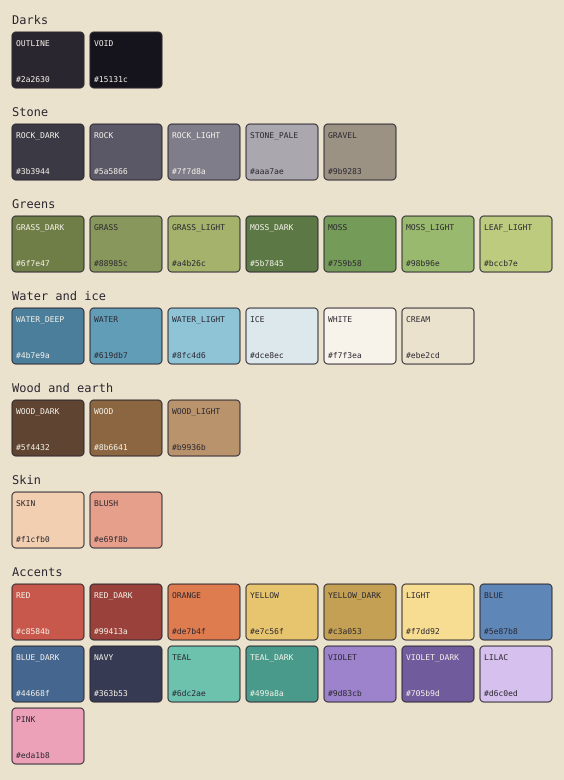

# The Iceland palette

Forty colours for everything the game draws in Iceland: ground, water, rock, moss, plants, wood, buildings, characters, the two aliens and the UI accents. The code lives in `src/art/palette.ts`; every sprite and tile in `src/systems/placeholders.ts` uses these names and nothing else. If a sprite needs a colour that is not here, the palette changes first and this page with it.

## Why one palette

Until now each sprite picked its own colours as it was written: about 120 distinct hex codes, three different near-blacks, five unrelated greens for grass, moss and canopies, pure white and pure black in places. Side by side they fought. The fix is a small shared set with a few rules:

- **Soft, slightly desaturated.** Nothing fully saturated, nothing pure white or pure black. The brightest white is a warm `#f7f3ea`; the darkest tone is the outline.
- **One outline colour** (`OUTLINE`, a warm near-black with a hint of plum) on every sprite and prop. Shadows are the same colour at low opacity, so lines and shadows belong to one family.
- **Fresh, warm greens.** The grass family is a clean spring green (yellow-side highlights, cool-side shade), not olive. Moss sits a step deeper and bluer. Both are warm enough that a field of grass, moss, canopies and shrubs reads as one landscape. The ochre of Iceland's tundra is carried by the gravel and wood tones, not by the grass base.
- **Three tones per material** at most: a base, a highlight, a shade. Stone and water have an extra step because they cover large areas.
- **The accents carry the colour.** Houses, coats, flowers, lamps and the aliens get the saturated notes. The ground stays quiet so they stand out.
- **Iceland still reads as Iceland:** ochre tundra, black lava with moss pillows, glacial blue, black sand, white ice.

## Reference style (described, not copied)

The owner pointed at *Fields of Mistria* as the kind of ground they like. Looking at it and writing down what makes it work, in words only:

- The grass base is a fresh mid green that is clearly green, not khaki. Highlights lean yellow, shade leans a little cool.
- Texture is small blade tufts (three-pixel "V" shapes in a lighter green, with the odd bright tip), scattered thinly, never a grid of single dots.
- Variation across a field comes from texture and soft lighter patches, not from switching base colour tile by tile, so the ground never reads as a checkerboard.
- Ground carries no dark outlines; the outline is kept for characters, props and trees, which lifts them off the ground.
- Plants and flowers are frequent but small, and read as light sprinkles over the green rather than dark blobs.

The tundra tiles follow those points: one base colour on every grass tile, three-blade tufts with a shade pixel beneath, a soft lighter blotch on the variant tile, and shrubs lit from the top so they sit in the field instead of punching holes in it.

## The colours

### Darks

| Name | Hex | Used for |
| --- | --- | --- |
| `OUTLINE` | `#2a2630` | The one outline on every sprite and prop; boulder base; dark grains in black sand; shadows at 30% and 22% opacity |
| `VOID` | `#15131c` | Outside the map, the rift floor, the night side of Earth |

### Stone

| Name | Hex | Used for |
| --- | --- | --- |
| `ROCK_DARK` | `#3b3944` | Black sand base, lava seams between moss, basalt body, dark basalt columns |
| `ROCK` | `#5a5866` | Basalt mid tone, black sand grains, ship feet, barrel bands, pumice holes |
| `ROCK_LIGHT` | `#7f7d8a` | Basalt highlight, ship hull, pipe, stepping stones, well, pebbles, sketch speckle |
| `STONE_PALE` | `#aaa7ae` | Ship upper band, light pebbles, geyser mouth, column tops, glacier dust, pale rock samples |
| `GRAVEL` | `#9b9283` | Gravel path base (warm, so the road is not another grey) |

### Greens

| Name | Hex | Used for |
| --- | --- | --- |
| `GRASS_DARK` | `#6a8c4e` | Shade pixel under each grass tuft, willow canopy shade |
| `GRASS` | `#88ac62` | The one grass base: every tundra tile, under boulders and stepping stones; birch canopy shade |
| `GRASS_LIGHT` | `#a6c676` | Grass tufts and light patches, birch canopy, cotton-grass stems |
| `MOSS_DARK` | `#557a4b` | Shade between moss pillows, rowan canopy shade, shrub body, lupine leaves, green house shade |
| `MOSS` | `#6f9a5e` | Moss pillows, rowan canopy, green house wall, Earth continents |
| `MOSS_LIGHT` | `#92ba78` | Lit side of moss pillows, moss on boulders and the cairn, rowan highlights |
| `LEAF_LIGHT` | `#c6db8c` | Brightest leaf highlight: grass tuft tips, moss pillow tops, birch and willow highlights, shrub tops |

### Water and ice

| Name | Hex | Used for |
| --- | --- | --- |
| `WATER_DEEP` | `#4b7e9a` | Dark ripples in deep water |
| `WATER` | `#619db7` | Glacial lake and sea base, waterfall body, glacier crevasses, Earth's lit ocean |
| `WATER_LIGHT` | `#8fc4d6` | Shallow water, hot pool base, water ripples, ship dome, ice shade, alien eye glint, church windows |
| `ICE` | `#dce8ec` | Ice tile, glacier face, waterfall foam, cotton-grass tufts, hot-pool highlights, Earth's caps |
| `WHITE` | `#f7f3ea` | Warm white: eye highlights, eye bands, trim, church walls, sparkle core, sketch outline |
| `CREAM` | `#ebe2cd` | Sweater yoke, hat band, birch trunk, dried fish, cut wood ends, church lower wall |

### Wood and earth

| Name | Hex | Used for |
| --- | --- | --- |
| `WOOD_DARK` | `#5f4432` | Signpost post, rowan trunk, doors, rack posts, pier plank lines, dark brown hair |
| `WOOD` | `#8b6641` | Fence rails, planter, barrel, woodpile, pier planks, rowan trunk highlight, mid-brown hair |
| `WOOD_LIGHT` | `#b9936b` | Signpost board, fence posts, bench, planter rim, Earth's deserts |

### Skin

| Name | Hex | Used for |
| --- | --- | --- |
| `SKIN` | `#f1cfb0` | Every human face |
| `BLUSH` | `#e69f8b` | Cheek pixels |

### Accents

| Name | Hex | Used for |
| --- | --- | --- |
| `RED` | `#c8584b` | Red house, church roof, rowan berries, mailbox, well roof |
| `RED_DARK` | `#99413a` | Red house shade, disguise A coat shade |
| `ORANGE` | `#de7b4f` | Disguise A coat |
| `YELLOW` | `#e7c56f` | Yellow house, disguise B headband, lit windows, lantern glass, flower centres |
| `YELLOW_DARK` | `#c3a053` | Yellow house shade |
| `LIGHT` | `#f7dd92` | Warm light: ship lamps, antenna tips, sparkle rays, lantern core, door knob, pipe glow, professor's eye glint |
| `BLUE` | `#5e87b8` | Blue house, disguise B coat, boat hull, Earth's ocean |
| `BLUE_DARK` | `#44668f` | Blue house shade, disguise B coat shade, boat waterline, Earth's deep ocean |
| `NAVY` | `#363b53` | Roofs, disguise A beanie, trousers, the cold seam in the rift |
| `TEAL` | `#6dc2ae` | The student's true form |
| `TEAL_DARK` | `#499a8a` | Student alien shade and feet |
| `VIOLET` | `#9d83cb` | Professor Lund's true form, lupine spikes |
| `VIOLET_DARK` | `#705b9d` | Professor's long coat |
| `LILAC` | `#d6c0ed` | Professor's bun, lupine highlights |
| `PINK` | `#eda1b8` | Wildflowers, planter flowers |

## Transparent shades

These are not extra colours, just palette colours at an opacity. They come from `alpha(name, opacity)` in `palette.ts`.

| Constant | Made from | Used for |
| --- | --- | --- |
| `SHADOW` | `OUTLINE` at 0.30 | Under characters, aliens, the column wall |
| `SHADOW_SOFT` | `OUTLINE` at 0.22 | Under trees, houses, racks, the glacier, pebbles |
| `alpha(WHITE, 0.15)` | | Corrugation highlights on house roofs |
| `alpha(WHITE, 0.33)`, `alpha(OUTLINE, 0.33)` | | Pickup-rock highlight and underside |
| `alpha(ICE, 0.85)`, `alpha(WHITE, 0.4–0.6)` | | Geyser column and steam |
| `alpha(LIGHT, 0.35)` | | Hot-pipe glow line |

## Colours that come from content

Some colours arrive from JSON that other sessions own: rock-sample colours and sketch colours in `content/`, NPC coats in `npcs.json`, and the NPC hair, skin and leg colours that `WorldScene` passes in. `placeholders.ts` runs all of these through `snap()`, which replaces any hex with the nearest palette colour. So content can keep using whatever hex it likes and the drawn result still lands on the palette. Today's snaps:

| Content colour | Snaps to |
| --- | --- |
| Basalt `#3a3d44` | `ROCK_DARK` |
| Obsidian `#15161c` | `VOID` |
| Pumice `#b9b4a6` | `STONE_PALE` |
| Sigrún's coat `#3f6a4a` | `MOSS_DARK` |
| NPC hair `#cfd2d8` | `ICE` |

If a snap looks wrong in play, the fix is to change the content hex to the palette hex you mean, not to add a colour.

## Mapping from the old colours

For anyone comparing against the previous look:

| Before | After |
| --- | --- |
| Outline `#1a1c20` (cold black) | `OUTLINE` `#2a2630` (warm, softer) |
| Pure `#ffffff`, `#f4f1e8`, `#f6fafc` | `WHITE` `#f7f3ea` |
| Grass `#7d9150` / `#86964f` (two olive bases) | One fresh green base `GRASS`; the second tile differs only in texture |
| Moss `#5f8a3f` / `#6f9a4a` / `#86b35a` / `#a3c86a` | `MOSS_DARK` / `MOSS` / `MOSS_LIGHT` / `LEAF_LIGHT` |
| Birch canopy `#7d9a3a` / `#9ab54a` / `#c9d96a` | `GRASS` / `GRASS_LIGHT` / `LEAF_LIGHT` (shares the grass family instead of its own) |
| Water `#4a93b5` / `#6fb3cf` / `#9fd0e3` | `WATER` / `WATER_LIGHT` / `ICE` |
| Hot pool `#7fd1e8` (bright cyan) | `WATER_LIGHT` |
| Lupine `#6c5fc7` / `#8e82e0` (electric) | `VIOLET` / `LILAC` (shares the professor's family) |
| House red `#c94a3a`, blue `#4f7fb8`, yellow `#e9c46a`, green `#5a8a5a` | `RED`, `BLUE`, `YELLOW`, `MOSS` |
| Three greys for metal, stone and basalt | The one stone ramp `ROCK_DARK` to `STONE_PALE` |

## Rules for new art

1. Pick from this page. Name the colour in code (`P.MOSS`), never the hex.
2. Three tones per material. If you need a fourth, you probably need a different material.
3. Outline with `OUTLINE`, shadow with `SHADOW` or `SHADOW_SOFT`. No other darks on edges.
4. Big areas (ground, water, walls) use the quiet colours. Saturated accents are for small things the player should notice.
5. A new colour is a palette change: add it to `palette.ts` and to this page in the same commit, and say why the existing 40 could not do the job.
